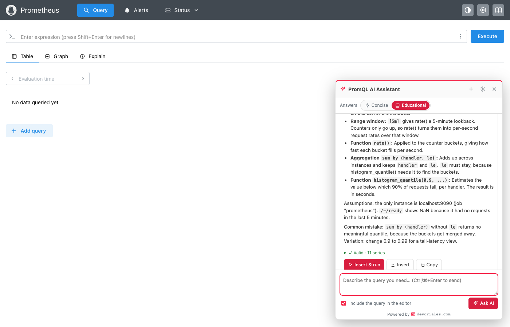

# PromQL AI Assistant

**Ask AI to write PromQL for you, right inside Prometheus.**

A Chrome extension that adds an **Ask AI** button to the Prometheus web UI. Describe what you want to see in plain words, for example *"p95 latency per route"* or *"which pods restart most?"*, and you get a working PromQL query built from the metrics that actually exist on your server.



## What it does

Writing PromQL means knowing metric names, label names, which functions fit which metric type, and a long list of gotchas. The assistant handles that for you:

1. **It looks at your real data.** It searches the metric names on your Prometheus and reads their labels and values, so it doesn't invent metrics.
2. **It writes the query** using the correct functions for each metric type, e.g. `rate()` on counters and `histogram_quantile()` with `le` on histograms.
3. **It tests the query** on your server before showing it, and marks it ✓ valid, ⚠ valid but empty, or ✗ error.
4. **One click inserts it** into the Prometheus editor and runs it.

It also **fixes and explains** the query already in the editor ("why is this empty?", "explain this query"), and it keeps the conversation going, so you can follow up with *"now only for namespace X"*.

It works with the Prometheus v3 UI, the classic v2 UI, and anything that serves the Prometheus HTTP API, such as Thanos, Mimir, Cortex or VictoriaMetrics.

## Two answer modes

Switch between them at the top of the chat panel. Your choice is remembered.

| Mode | You get | Good for |
|---|---|---|
| ⚡ **Concise** (default) | The query plus a one- or two-sentence explanation | Getting the query fast when you know PromQL |
| 📖 **Educational** | The query, a piece-by-piece breakdown (selector, range window, functions, aggregation), why each part is there, and a common mistake or useful variation | Learning PromQL, onboarding teammates, understanding someone else's query |

## Connecting to the AI

The assistant uses Claude (by Anthropic). Pick one of three ways to connect on the options page:

| Option | What you need | Billing |
|---|---|---|
| **API key** | An Anthropic API key | Pay per use on your API account |
| **API gateway / proxy (token)** | Your company's LLM gateway URL and a token (LiteLLM, internal proxy, Bedrock/Vertex gateway…) | Whatever your gateway bills |
| **Claude subscription** (Pro / Max / Ultra) | Claude Code installed and logged in on your computer | Counts toward your plan's usage limits |

### Using your Claude subscription

A browser extension can't sign in with a Claude subscription directly. Anthropic supports subscription use through Claude Code. So the extension talks to the `claude` CLI already logged in on your computer, through a small local bridge (a Chrome *native messaging host*). Set it up once:

```bash
claude                  # run /login and sign in with your subscription (once)
npm run bridge:install  # registers the bridge for Chrome, Edge, Brave, Arc (macOS / Linux)
```

How the bridge stays contained:

- It runs Claude with **all tools disabled**, so it can only answer in text.
- It runs in safe mode, so your own CLAUDE.md files, hooks, plugins and MCP servers aren't loaded.
- It accepts requests only from this extension.
- It removes `ANTHROPIC_API_KEY` from its environment, so usage bills your subscription and not an API key ([why](https://support.claude.com/en/articles/11145838-use-claude-code-with-your-pro-max-or-ultra-plan)). You can turn this off.

Remove it with `npm run bridge:uninstall`.

## Install

Requires Node.js 20+ and Chrome (or another Chromium-based browser).

```bash
git clone https://github.com/devoriales/prometheus-browser-extension.git
cd prometheus-browser-extension
npm install
npm run build
```

1. Open `chrome://extensions` and turn on **Developer mode** (top right).
2. Click **Load unpacked** and choose the `dist` folder.
3. On the extension's card, click **Details** → **Extension options**.
4. **Section 1:** choose how to connect to the AI and click **Test connection**.
5. **Section 2:** add your Prometheus. Enter a name and the base URL you open Prometheus at, e.g. `https://prometheus.example.com/` (include a route prefix like `/prometheus/` if you have one).
6. Click **Save**, then **Allow** when Chrome asks for access to that site.
7. Reload your Prometheus tab and click **Ask AI** in the bottom-right corner, or press **Alt+Shift+P**.

Tip: pin the extension. Clicking its icon on a Prometheus page you haven't added yet opens the options with that server filled in.

## Settings

All on the options page:

- **Prometheus servers.** Add as many as you like. Each has optional extra API headers (e.g. `X-Scope-OrgID: tenant-a` for Mimir/Cortex) and notes for the AI ("services are identified by the `app` label"). Requests use your existing browser login, so SSO and cookies just work.
- **Model and effort.** API key and gateway default to `claude-opus-5-5` at medium effort. `claude-sonnet-5-5` and `claude-haiku-5-5` are faster and cheaper. With the subscription you can pick `opus`, `sonnet` or `haiku`.
- **Answer style.** Concise or Educational (also switchable in the chat).
- **Query checking.** Run as an instant query (default, most accurate), syntax check only (never executes), or off.
- **Team instructions.** Added to every question, e.g. "always filter by `cluster`" or "use our `job:` recording rules".
- **Insert mode.** Edit the editor in place (default, keeps undo history), or reload the page with the query in the URL.

## Privacy

Your questions and Prometheus context go to the AI provider you configured. That includes the query in the editor (you can untick this per question), metric names and types, and the label values and query results the assistant looks up. Make sure that's acceptable for your data. API keys and tokens are stored only in this browser's local extension storage and never synced. Other settings sync through your Chrome profile.

## How it works

```
Prometheus page (content script)              Service worker                     AI
┌─────────────────────────────┐   Port   ┌───────────────────────┐
│ chat panel (shadow DOM)     │◄────────►│ chat session tool loop│──► Claude Messages API (key / gateway)
│ tools → Prometheus HTTP API │ toolCall │  AnthropicEngine      │
│ (same origin, your session) │ result   │  ClaudeCodeEngine ────┼──► native host ─► claude -p (subscription)
│ insert & run in the editor  │          └───────────────────────┘
└─────────────────────────────┘
```

- **Tools:** `search_metrics`, `get_metric_labels`, `run_query` and `submit_query` run in the page, so they reach Prometheus exactly the way you do.
- **Prompt caching:** the instructions and your server's metric list form a stable, cached prefix. The answer style, the editor contents and your question go into each message.

## Development

```bash
npm run watch        # rebuild dist/ on change, then click ↻ on the extension in chrome://extensions
npm run typecheck
npm test             # unit tests
```

End-to-end tests run real Chromium with the extension against real Prometheus v3 and v2 in Docker:

```bash
docker run -d --name promql-ai-v3 -p 19090:9090 prom/prometheus:v3.5.0
docker run -d --name promql-ai-v2 -p 19091:9090 prom/prometheus:v2.55.1
npx playwright install chromium
npm run test:e2e     # scripted mock of the AI API (no key needed)
npm run test:live    # live, through your Claude Code subscription (uses a little of your plan)
```

To change the toolbar icon, edit `scripts/icon.svg` and run `node scripts/render-icons.mjs`.

## Limitations

- Chromium-based browsers only (Manifest V3). The subscription bridge installer supports macOS and Linux.
- Inserting targets the last-focused query editor, or the first one on the page.
- AI-written queries are tested against your server, but read a query before you build alerts on it.

---

<p align="center">Powered by <a href="https://devoriales.com"><b>devoriales.com</b></a></p>
